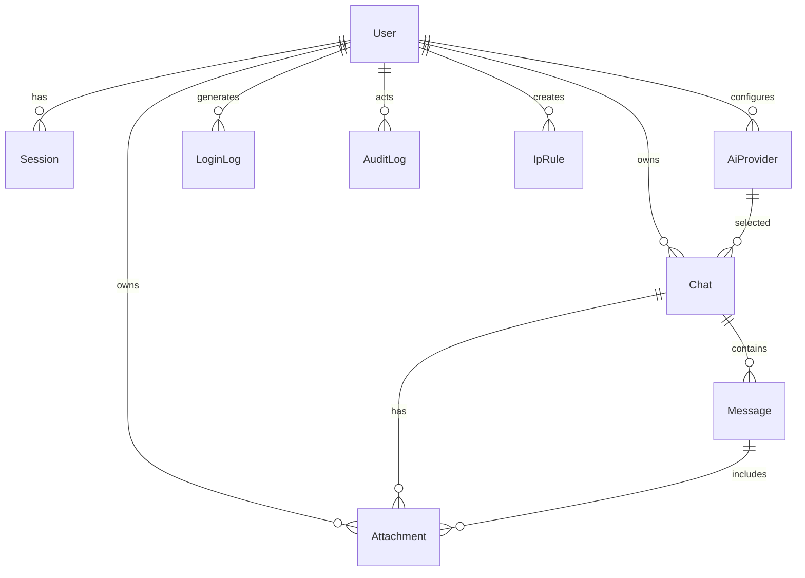

# 数据库与数据隔离

PostgreSQL + Prisma。迁移位于 `prisma/migrations/`，生产使用 `prisma migrate deploy`（容器入口自动执行），开发用 `prisma migrate dev`。数据库不保存任何明文 API Key、聊天正文、聊天标题、附件名或附件内容。

## 表与字段

### User
`id`(uuid)、`username`(唯一, ≤32)、`email`(唯一, ≤254)、`emailVerified`、`passwordHash`(Argon2id)、`role`(OWNER/USER)、`status`(ACTIVE/DISABLED)、`displayName`、`createdAt`、`updatedAt`、`lastLoginAt`。索引：`role`、`status`。
约束：唯一超级管理员由 CLI 与业务层共同保证（`ownerCount` 检查；管理员接口不能创建 OWNER）。

### Session
`tokenHash`(唯一, SHA-256)、`csrfHash`(SHA-256)、`userId`、`ip`、`userAgent`、`createdAt`、`lastSeenAt`、`expiresAt`、`revokedAt`。用户删除级联；过期/撤销立即失效；禁用用户时服务端拒绝其全部会话。

### Chat
`userId`、`titleCiphertext`、`modelProviderId`、`modelId`、时间戳。`userId+updatedAt` 索引。删除用户级联；删除模型时 `providerId` 置空，历史聊天仍可读。
**隔离**：所有查询都带 `userId`（`getChatDetail`、`listChats`），不存在“按 id 直取后由前端判断”的路径。

### Message
`chatId`、`role`(SYSTEM/USER/ASSISTANT)、`contentCiphertext`、`modelId`、`providerId`、`status`(COMPLETE/PARTIAL/ERROR)、`errorCode`、token 统计、时间戳。`chatId+createdAt` 索引。删除聊天级联。
**隔离**：先验证聊天属于当前用户，再按 `chatId` 读取/写入；跨用户返回 404（不泄露存在性）。

### Attachment
`userId`、`chatId`、`messageId`、`kind`(IMAGE/FILE/AUDIO)、`originalNameCiphertext`、`mime`、`size`、`sha256`、`storageKey`(唯一)、`extractedTextCiphertext`、`chunksCiphertext`、`createdAt`。
**隔离**：下载接口同时校验 `attachment.userId === session.userId`；文件名与内容均加密。磁盘文件名为随机 key，不使用原始文件名。

### AiProvider
`ownerType`(GLOBAL/USER)、`userId`、`name`、`baseUrl`、`apiKeyCiphertext`、`modelId`、`capabilities`(JSON: text/vision/files/audio)、`params`(JSON)、`enabled`、`isDefault`。
全局模型仅 OWNER 可管理；个人模型仅本人可管理；用户只能看到全局启用模型 + 自己的模型。API Key 永不返回浏览器，列表只返回掩码。

### IpRule
`cidr`(唯一, 规范化)、`label`、`enabled`、`expiresAt`、`createdById`、`lastMatchedAt`。
**默认拒绝**：没有匹配规则即 403。`expiresAt` 到期的规则不参与匹配。管理接口阻止禁用/删除“最后一条覆盖当前管理员 IP 的规则”（409 `LOCKOUT_RISK`），防止把自己锁在门外。

### IpAccessLog
`ip`、`path`、`method`、`allowed`、`reason`、`userAgent`、`createdAt`。只记录 IP/路径/UA/结果，不记录 Cookie、密码、正文或完整密钥。同一 IP+路径 5 秒节流；成功访问 5 分钟节流。

### LoginLog
`userId?`、`identifier`、`ip`、`userAgent`、`success`、`reason`、`createdAt`。失败原因只记粗粒度（如 `invalid_credentials`），不记录密码。

### AuditLog
`actorId?`、`actorLabel`、`action`、`targetType`、`targetId`、`before`/`after`(JSON)、`ip`、`userAgent`、`status`、`error`、`createdAt`。`before/after` 经 `audit.ts` 脱敏；API Key 只记录“已变更”，不记录明文。普通用户无读取接口。

### SystemConfig
`key`、`value`(JSON)、`updatedAt`、`updatedById`。允许的键只有 `siteName`、`registrationOpen`、`defaultProviderId`、`maxUploadMB`、`maintenanceNotice`，未知键忽略，防止通过配置注入任意行为。

### EmailToken
`email`、`purpose`(REGISTER/RESET/EMAIL_CHANGE)、`codeHash`(HMAC)、`username?`、`userId?`、`expiresAt`、`consumedAt`、`attempts`、`ip`、`createdAt`。
验证码 6 位、10 分钟、单次使用、绑定邮箱与用途；错误尝试计数；请求限速由内存 limiter + Nginx 共同承担。

## ER 图



## 隔离与权限规则

- 页面与 API 全部在服务端解析会话（`getSession`），不信任前端传入的 `userId`。
- 每个聊天/附件查询都包含所有权条件；跨用户访问统一返回 404。
- 管理员接口统一 `requireOwner`；普通用户访问返回 403（页面也重定向）。
- 删除用户时数据库级联清理其聊天、消息、附件、会话、模型（配置中的 `onDelete: Cascade`）；审计保留 `actorId=null` + `actorLabel` 供追溯。
- 聊天标题/正文/文件名/提取文本/分块/Provider Key 均为密文列；数据库泄露不等于内容泄露。

## 迁移与初始化

```bash
npm run db:migrate        # prisma migrate deploy
npm run db:migrate:dev    # 开发新迁移
npm run bootstrap -- ...  # 唯一 OWNER + 初始 IP + 默认设置
```

生产启动顺序：数据库健康 → `migrate deploy` → bootstrap（仅一次）→ App → Nginx → 对外。不要用 `db push` 替代生产迁移。

## 备份与保留

- 数据库与上传目录一起备份，格式见 [BACKUP_RESTORE.md](BACKUP_RESTORE.md)。
- 建议保留 7 份日备份 + 1 份月备份；备份文件本身已加密，仍应存放在不同介质/账户。
- 日志表可按需在运维窗口清理（`IpAccessLog`、`LoginLog`），但不要删除 `AuditLog` 中与安全事件相关的记录；家庭规模通常无需自动清理。
