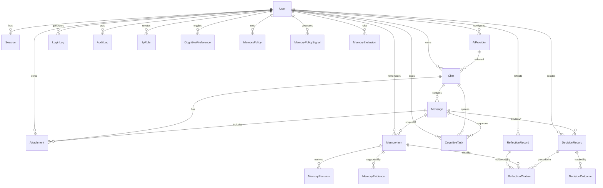

# 数据库与数据隔离

PostgreSQL + Prisma。迁移位于 `prisma/migrations/`，生产使用 `prisma migrate deploy`（容器入口自动执行），开发用 `prisma migrate dev`。数据库不保存任何明文 API Key、聊天正文、聊天标题、附件名或附件内容。

## 表与字段

### User
`id`(uuid)、`username`(唯一, ≤32)、`email`(唯一, ≤254)、`emailVerified`、`passwordHash`(Argon2id)、`role`(OWNER/USER)、`status`(ACTIVE/DISABLED)、`displayName`、`createdAt`、`updatedAt`、`lastLoginAt`。索引：`role`、`status`。
约束：唯一超级管理员由 CLI 与业务层共同保证（`ownerCount` 检查；管理员接口不能创建 OWNER）。

### Session
`tokenHash`(唯一, SHA-256)、`csrfHash`(SHA-256)、`userId`、`ip`、`userAgent`、`createdAt`、`lastSeenAt`、`expiresAt`、`revokedAt`。用户删除级联；过期/撤销立即失效；禁用用户时服务端拒绝其全部会话。

### Chat
`userId`、`titleCiphertext`、`modelProviderId`、`modelId`、时间戳。`userId+updatedAt` 索引。删除用户级联；删除模型时 `providerId` 置空，历史聊天仍可读。
**隔离**：所有查询都带 `userId`（`getChatDetail`、`listChats`），不存在“按 id 直取后由前端判断”的路径。

### Message
`chatId`、`role`(SYSTEM/USER/ASSISTANT)、`contentCiphertext`、`modelId`、`providerId`、`status`(COMPLETE/PARTIAL/ERROR)、`errorCode`、token 统计、时间戳。`chatId+createdAt` 索引。删除聊天级联。
**隔离**：先验证聊天属于当前用户，再按 `chatId` 读取/写入；跨用户返回 404（不泄露存在性）。

### Attachment
`userId`、`chatId`、`messageId`、`kind`(IMAGE/FILE/AUDIO)、`originalNameCiphertext`、`mime`、`size`、`sha256`、`storageKey`(唯一)、`extractedTextCiphertext`、`chunksCiphertext`、`createdAt`。
**隔离**：下载接口同时校验 `attachment.userId === session.userId`；文件名与内容均加密。磁盘文件名为随机 key，不使用原始文件名。

### AiProvider
`ownerType`(GLOBAL/USER)、`userId`、`name`、`baseUrl`、`apiKeyCiphertext`、`modelId`、`capabilities`(JSON: text/vision/files/audio)、`params`(JSON)、`enabled`、`isDefault`。
全局模型仅 OWNER 可管理；个人模型仅本人可管理；用户只能看到全局启用模型 + 自己的模型。API Key 永不返回浏览器，列表只返回掩码。

### IpRule
`cidr`(唯一, 规范化)、`label`、`enabled`、`expiresAt`、`createdById`、`lastMatchedAt`。
**默认拒绝**：没有匹配规则即 403。`expiresAt` 到期的规则不参与匹配。管理接口阻止禁用/删除“最后一条覆盖当前管理员 IP 的规则”（409 `LOCKOUT_RISK`），防止把自己锁在门外。

### IpAccessLog
`ip`、`path`、`method`、`allowed`、`reason`、`userAgent`、`createdAt`。只记录 IP/路径/UA/结果，不记录 Cookie、密码、正文或完整密钥。同一 IP+路径 5 秒节流；成功访问 5 分钟节流。

### LoginLog
`userId?`、`identifier`、`ip`、`userAgent`、`success`、`reason`、`createdAt`。失败原因只记粗粒度（如 `invalid_credentials`），不记录密码。

### AuditLog
`actorId?`、`actorLabel`、`action`、`targetType`、`targetId`、`before`/`after`(JSON)、`ip`、`userAgent`、`status`、`error`、`createdAt`。`before/after` 经 `audit.ts` 脱敏；API Key 只记录“已变更”，不记录明文。普通用户无读取接口。

### SystemConfig
`key`、`value`(JSON)、`updatedAt`、`updatedById`。允许的键只有 `siteName`、`registrationOpen`、`defaultProviderId`、`maxUploadMB`、`maintenanceNotice`，未知键忽略，防止通过配置注入任意行为。

### EmailToken
`email`、`purpose`(REGISTER/RESET/EMAIL_CHANGE)、`codeHash`(HMAC)、`username?`、`userId?`、`expiresAt`、`consumedAt`、`attempts`、`ip`、`createdAt`。
验证码 6 位、10 分钟、单次使用、绑定邮箱与用途；错误尝试计数；请求限速由内存 limiter + Nginx 共同承担。

## 认知层表

认知层的十二张表全部以 `userId` 为隔离锚点，删除用户时逐行级联。只有 `MemoryExclusion` 的 `chatId`/`sourceMessageId` 故意不建外键（排除必须比来源活得久），其余关系都是真外键。
其中四条边是**复合外键**（`(id, userId)` 成对引用）：`DecisionOutcome→DecisionRecord`、`ReflectionCitation→ReflectionRecord`、`ReflectionCitation→MemoryItem`，加上 `MemoryItem`/`ReflectionRecord` 为支撑它们而建的 `@@unique([id, userId])`。跨用户连边在库层就插不进去，不靠应用层记得校验。

### CognitivePreference
`userId`(主键)、八个模块开关（`memoryEnabled`、`userModelEnabled`、`emotionEnabled`、`associationEnabled`、`timelineEnabled`、`reflectionEnabled`、`decisionMemoryEnabled`、`adaptiveMemoryEnabled`）、`emotionTransparency`(OFF/IMPLICIT/EXPLICIT)、`reflectionSweptAt?`、时间戳。
**默认全关**：库里没有行时应用层补 `OFF`，开关由服务端在每个模块入口读取，前端传什么都不算。`reflectionSweptAt` 不是设置项，是后台那趟反思扫描的节流标记。

### MemoryPolicy
复合主键 `(userId, context)`，七个情境各一行。`allowPersistence`、`allowedMemoryTypes[]`、`requireConfirmation`、`retention`(SESSION_ONLY/…)、`allowUserProfile`、`allowReflection`、`allowAssociation`。
`learnedAt` 非空＝这一档被策略学习层自动收紧过；`manualOverrideAt` 非空＝用户亲手定过，学习层从此不再碰它。库里没有行时由应用层补齐内置默认（最保守的一档）。

### MemoryPolicySignal
`id`、`userId`、`context`、`createdAt`，索引 `(userId, context, createdAt)`。只有「永久删除」会留下信号，没有正文、没有原因——它只回答「这个情境被撤过」，不回答撤的是什么。

### MemoryItem
`userId`、`chatId?`、`sourceMessageId?`、`type`、`context`、`origin`、`contentCiphertext`、`confirmedAt?`、`version`、`supersededAt?`、`validFrom?`、`validTo?`、`validPrecision`、`recordedAt`、`updatedAt`。索引 `(userId, supersededAt)`、`(userId, type)`。
双时间模型：`validFrom/validTo` 是事实成立的区间，`recordedAt` 是系统记下的时间，两者互不替代。正文用 AES-GCM 加密，AAD 绑住 `userId` 与记录 id，整表导出读不出内容。

### MemoryRevision
`userId`、`action`、`memoryId`、`previousId?`、`reasonCiphertext`、`sourceMessageId?`、`createdAt`。索引 `(memoryId)`、`(previousId)`、`(userId, createdAt)`。
一次演化的边，正文不复制：改口时给旧行盖 `supersededAt` 并新写一行，历史逐条可读，谁都不被覆盖。

### MemoryExclusion
`userId`、`contentHash`(HMAC(APP_SECRET, userId:归一化正文))、`contentCiphertext`、`chatId?`、`sourceMessageId?`、`createdAt`。唯一 `(userId, contentHash)`。
**`chatId`/`sourceMessageId` 故意不建外键**：排除必须比来源活得久，会话删掉之后那句话仍然不该被重新记住。密文列只为界面能显示和撤销，只有哈希用户认不出哪条是哪条。

### MemoryEvidence
`userId`、`memoryId`、`kind`、`origin`、`sourceMessageId?`、`sourceChatId?`、`noteCiphertext?`、`createdAt`。唯一 `(userId, memoryId, kind, sourceMessageId)`，索引 `(userId, memoryId)`。
置信度不存在 `MemoryItem` 上，读时按这些证据算——存一列就要维护刷新时机，漏一处就是一个过期的假数字。`sourceMessageId` 可空是给手工输入的记忆留的，PostgreSQL 唯一索引把 NULL 视为互不相同，这一类去重由服务层负责。

### CognitiveTask
`id`、`userId`、`chatId`、`sourceMessageId`、`kind`、`status`(PENDING/RUNNING/DEAD)、`attempts`、`availableAt`、`leaseOwner?`、`leaseUntil?`、`lastErrorCode?`、时间戳。唯一 `(sourceMessageId, kind)`，索引 `(status, availableAt)`、`(userId, chatId)`。
一行＝「这一句话的认知写入还欠着」。**表里没有任何正文**：要重建这一轮，靠 `sourceMessageId` 把 Message 行解密出来，所以「派生数据不许出现明文」这条红线在这里是结构上违反不了的——没有可以放正文的列。
`attempts` 在领取时 +1（不是失败时 +1），崩在执行半路也要占掉一次；`leaseOwner` 同时是 fencing token，租约过期被下一任领走后，上一任僵尸执行的所有完结写入都会因 owner 不匹配命中 0 行。待重试没有独立状态：那是「PENDING 且 `availableAt` 在未来」。
成功即删行、作废也删行（区别只在日志事件名），所以这张表只装欠着的活，不是历史表；只有判死的 DEAD 行会留下，由 `npm run logs:prune` 按保留期清掉。

### DecisionRecord
`id`、`userId`、`category`(TECH_CHOICE/PROJECT_PLANNING/CAREER/LEARNING/PURCHASE/PERSONAL_GOAL)、`status`(PENDING_CONFIRM/CONFIRMED/AWAITING_REVIEW/OUTCOME_RECORDED/REJECTED)、九个内容列全密文（`topicCiphertext`、`choiceCiphertext` 必填，background/constraints/options/reason/criteria/expectedOutcome/risks 可空）、`decidedAt?`、`reviewAfter?`、`confirmedAt?`、`sourceMessageId`(必填)、时间戳。唯一 `(id, userId)`、`(sourceMessageId, category)`，索引 `(userId, status)`。
**只有 CONFIRMED 才算正式决策记录**（7.4 门槛 8）：后台只写 PENDING_CONFIRM，确认由用户在界面做；REJECTED 是终态，留着只为「同一条不再反复来问」。AAD 形如 `decision:v1:用户:记录:字段名`，绑住字段名，所以一列的密文换不到另一列上。

### DecisionOutcome
`id`、`userId`、`decisionId`、`linkStatus`(CANDIDATE/LINKED/DETACHED)、五个内容列密文（`actualCiphertext` 必填，gap/rating/missedFactors/lesson 可空）、`sourceMessageId`、`recordedAt`。唯一 `(sourceMessageId, decisionId)`，索引 `(userId, decisionId)`、`(userId, linkStatus)`。
`linkStatus` 默认 CANDIDATE：5.3 不许把结果好坏静默归因到某个单一选择上，关联要用户确认或解除才生效。`decision DecisionRecord @relation(fields: [decisionId, userId], references: [id, userId])`——复合外键，结果行不可能指到别人的决策上。

### ReflectionRecord
`id`、`userId`、`type`(任务书 6.1 的七类)、`status`(六态，默认且只能以 PENDING 落地)、`dedupKey`(VARCHAR(80))、`titleCiphertext`、`bodyCiphertext`、`alternativesCiphertext?`、`counterTokensCiphertext`、`counterHitCount`、`timeFrom?`、`timeTo?`、`timePrecision`、`sampleCount`、`observationSpanDays`、`confidence`、`importance`、`generatedAt`、`snoozedUntil?`、`expiresAt?`、`decidedAt?`、`updatedAt`。唯一 `(id, userId)`、`(userId, dedupKey)`，索引 `(userId, status)`、`(userId, generatedAt)`。
`dedupKey` 上的库层唯一让同主题的第二条插不进来（6.6 的合并不是靠应用层记着）。`counterTokensCiphertext` 是反证搜索用过的关键词集合——它同样是记忆正文的派生物，所以按同一口径加密；`counterHitCount=0` 也要留行，门槛 4 要的是「搜过反证」有凭据。`sampleCount`/`observationSpanDays` 摊在界面上，是数据不足（INSUFFICIENT_EVIDENCE）的判据本身。

### ReflectionCitation
`id`、`userId`、`reflectionId`、`memoryId?`、`decisionId?`、`kind`(SUPPORTS/CONTRADICTS)、`createdAt`。唯一 `(reflectionId, memoryId)`、`(reflectionId, decisionId)`，索引 `(userId, reflectionId)`、`(userId, memoryId)`、`(userId, decisionId)`。两侧来源都是复合外键。
一条洞察引用了哪条证据、站在支持还是反对的一侧。来源可以是记忆，也可以是决策——6.1 的 DECISION_LESSON 和「决策落定」那一类 MILESTONE 的证据本来就是 `DecisionRecord` 那两行，硬转写成记忆 id 就是造假。**恰好一列非空由服务层保证**：Prisma 表达不了 CHECK，而手写进迁移的 CHECK 会让下一次 `migrate diff` 想把它删掉。
用连接表而不是把 id 串成文本写进洞察里，为的是来源被永久删除时这条引用随行消失（任务书 7.3 的派生清理），读侧再按剩下几条判这条洞察还该不该留着。

## ER 图



## 隔离与权限规则

- 页面与 API 全部在服务端解析会话（`getSession`），不信任前端传入的 `userId`。
- 每个聊天/附件查询都包含所有权条件；跨用户访问统一返回 404。
- 管理员接口统一 `requireOwner`；普通用户访问返回 403（页面也重定向）。
- 删除用户时数据库级联清理其聊天、消息、附件、会话、模型（配置中的 `onDelete: Cascade`）；审计保留 `actorId=null` + `actorLabel` 供追溯。
- 聊天标题/正文/文件名/提取文本/分块/Provider Key 均为密文列；数据库泄露不等于内容泄露。

## 迁移与初始化

```bash
npm run db:migrate        # prisma migrate deploy
npm run db:migrate:dev    # 开发新迁移
npm run bootstrap -- ...  # 唯一 OWNER + 初始 IP + 默认设置
```

生产启动顺序：数据库健康 → `migrate deploy` → bootstrap（仅一次）→ App → Nginx → 对外。不要用 `db push` 替代生产迁移。

## 备份与保留

- 数据库与上传目录一起备份，格式见 [BACKUP_RESTORE.md](BACKUP_RESTORE.md)。
- 建议保留 7 份日备份 + 1 份月备份；备份文件本身已加密，仍应存放在不同介质/账户。
- 日志表可按需在运维窗口清理（`IpAccessLog`、`LoginLog`），但不要删除 `AuditLog` 中与安全事件相关的记录；家庭规模通常无需自动清理。

## 性能参数（PostgreSQL）

下表是在 2026-11-01 对本机实例（PostgreSQL 17.11，数据目录 `D:\FamilyAIChat\pgdata`）实测得到的当前值。`context` 一栏同样取自 `pg_settings`，决定改完要不要重启。这些都属于运维动作，仓库里的代码和脚本不会自动执行。

| 参数 | 当前 | 建议 | context | 原因 |
| --- | --- | --- | --- | --- |
| `random_page_cost` | 4 | 1.1 | user（不用重启） | 数据盘实测为 NVMe SSD（Crucial CT1000P3PSSD8，D: 与系统同盘）。默认值 4 是为机械盘调的，会让规划器认为「走索引 = 大量随机 IO」从而选顺扫，`(userId, createdAt)`、`(ip, createdAt)`、`(action, createdAt)` 这些复合索引在分页查询里就用不上。 |
| `effective_cache_size` | 4 GB | 与 `shared_buffers` 一起提高 | user（不用重启） | 只影响规划器估算，不占内存；设小了同样会把索引方案判贵。 |
| `work_mem` | 4 MB | 保持 | user（不用重启） | 会话消息按 `createdAt` 排序、附件按用户聚合都在这个预算内；调高对当前查询没有可观察收益。 |
| `shared_buffers` | 128 MB | 物理内存的 1/4 | postmaster（要重启） | 默认值。家用机器内存富余时上调能减少密文列的重复读盘。 |
| `max_connections` | 100 | 保持 | postmaster（要重启） | 要和连接串里的 `connection_limit` 一起看：应用池 + `pg_dump` + 迁移 + 手工 psql 必须共用这 100 个槽位。 |

应用侧对应地把连接串写成 `... ?schema=public&connection_limit=8&pool_timeout=10`（`.env.example` 和 `docker-compose.yml` 已同步）。显式上限的意义不是「更快」，而是把占用钉死：Prisma 的默认池大小是 `物理核数 × 2 + 1`，本机 8 个物理核，单实例默认就能开到 17 条连接，而 `server.js`、`prisma migrate`、备份脚本、手工 psql 共用同一个 `max_connections = 100`。家庭规模的真实并发远小于 8，钉在 8 条不会造成排队，同时给备份和迁移留足余量。

`context = user` 的三个参数可以零停机改掉，按库设置即可，不需要重启也不需要改配置文件：

```bash
# 只影响 family_chat 库，立刻对新连接生效；已在池里的旧连接沿用到下次回收
psql -U family_chat -d family_chat -c "ALTER DATABASE family_chat SET random_page_cost = 1.1;"
psql -U family_chat -d family_chat -c "ALTER DATABASE family_chat SET effective_cache_size = '8GB';"
# 验证：新开会话读到的应当是 1.1
psql -U family_chat -d family_chat -c "SHOW random_page_cost;"
```

想全实例生效就用 `ALTER SYSTEM SET ...` + `SELECT pg_reload_conf();`，同样不用重启。只有 `shared_buffers` / `max_connections` 需要重启：Linux 走 `systemctl restart postgresql`，Windows 改 `D:\FamilyAIChat\pgdata\postgresql.conf` 后重启 PostgreSQL 服务。

一条反直觉的记录，避免后来的人「优化」错方向：密文列是 base64 字符串，TOAST 压缩对它是有效的——实测 `enc:v1:` 载荷用 deflate 能从 100% 压到约 75%（省的是 base64 那 25% 冗余，不是密文本身）。所以不要把这些列改成 `STORAGE EXTERNAL` 关掉压缩，那只会让磁盘和 IO 都多花约三分之一。

## 读写路径上已经做掉的事

- 列表类查询（会话详情、更早消息、附件库）用投影 `ATTACHMENT_PUBLIC_SELECT`，把两个大列 `chunksCiphertext` 和 `extractedTextCiphertext` 都挡在内存之外；只有真的要给模型做检索增强时才整行取。两个大列都省掉的前提是 DTO 上那个 `hasText` 标记一并去掉——界面从没读过它，只有上传回执在读，所以改成上传路由单独用整行现算（`uploadedAttachment`），页面列表走投影（`publicAttachment`）。
- `textSkipped`（「这个文件太大，没给你抽正文」的提示）也不再回读正文列去核对，改由 `parseSkippedFor(mime, size)` 直接算。等价性靠的是写入顺序：`inspectUpload` 先用 `mime` 和 `buffer.length` 判定要不要抽文本，抽了才写正文列，而存进库的 `mime`/`size` 就是那两个入参。所以「这行有正文」⟹「当时判定不该跳过」，反过来「没正文且按 mime/size 该跳过」和「按 mime/size 该跳过」是同一个条件。代价是这条线**只能上调不能下调**：历史上按旧线抽过正文、体积却在新线之上的行会被误标成跳过，这个约束写在 `TEXT_PARSE_MAX_BYTES` 的注释上。
- 摘掉正文列的收益实测（临时表、不可压缩密文、墙钟计时，100 个附件的一页）：每份正文 20 KB 时 **24.0 ms → 1.2 ms**，200 KB 时 **83.2 ms → 1.7 ms**，2 MB 时 **807.4 ms → 1.1 ms**。上限是真实存在的：抽取文本在 `src/lib/files.ts:227` 硬截到 2,000,000 字符（约 2.7 MB base64 密文），一页历史 60 条消息（`src/lib/chats.ts:167`）× 每条最多 15 个附件（`src/lib/validation.ts:79`）= 900 个附件，附件库一页 `take: 500`（`src/lib/chats.ts:447`）。注意测量方法本身有坑：`EXPLAIN (ANALYZE, BUFFERS)` 对大文本列会严重低报（142 MB 那一档只报 `local hit=4`、`quicksort Memory: 31kB`），必须用墙钟加到端字节；另外用 `repeat('x', N)` 造的数据会被 TOAST 压扁到几百字节原地存放，测不出 IO。
- 一条用户消息只产生一次 `Chat` UPDATE（活跃时间 + 本轮模型 + 自动标题合并），`updatedAt` 由 `@updatedAt` 自动带上。
- 管理员首页的目录体积统计按 32 个一批并发 `stat`，不再串行等每个文件一次往返。
- IP 白名单缓存把规则查询移出请求路径：冷启动 await 一次，之后由定时器按 `IP_CACHE_MS` 预热，被扫描时数据库的查询频率恒定而不是随请求线性增长。

日志检索仍然用子串匹配（`contains`），没有改成前缀匹配。原因是这个库的 collation 实测为 `Chinese (Simplified)_China.936`，非 C 排序下 `(ip, createdAt)`、`(action, createdAt)` 的 btree 索引服务不了 `LIKE 'x%'`，要额外建 `varchar_pattern_ops` 索引才有意义。在没有那套索引之前，改前缀只会缩小管理员能搜到的范围，换不来任何速度。

## 记忆读侧索引：实测后暂不做

检索热路径的形状是「`userId` 等值 + `supersededAt IS NULL` + `origin NOT IN` + `validFrom/validTo` 双 `OR` + `ORDER BY recordedAt DESC LIMIT n`」（`src/lib/cognitive/memory-module.ts` 的 `MEMORY_RETRIEVAL_POOL = 200`，截断到 8 条）。已有索引只有 `@@index([userId, supersededAt])`，看起来「缺一个 `recordedAt`」，实测下来这个直觉是错的。

方法：临时表 `bench_mem`（`ON COMMIT DROP`，包在同一个 `$transaction` 里才看得见），单用户 `bench-user`，只变未取代行数，跑真实的 `EXPLAIN (ANALYZE, BUFFERS)`。

| 未取代行数 | A 现状 `[userId, supersededAt]` | B 原拟 `[userId, supersededAt, recordedAt]` | C 偏索引 `(userId, recordedAt DESC) WHERE supersededAt IS NULL` |
| --- | --- | --- | --- |
| 320 | 0.251 ms（Sort，`hit=25`） | — | 0.238 ms（**仍走 Sort，优化器没选它**） |
| 800 | 0.610 ms（`hit=63`） | — | 0.126 ms（Index Scan，`hit=194 read=2`） |
| 3200 | 1.414 ms（`hit=250`） | — | 0.139 ms |
| 8000 | 3.365 ms（`hit=625`） | 2.848 ms（**计划未变，仍 Bitmap Heap Scan + top-N heapsort**） | 0.179 ms |
| 40000 | 13.536 ms（`local read=3125`） | 14.989 ms（**仍 Sort**） | 0.752 ms（`hit=67 read=136`） |

三个结论：

1. **B（在现有索引上补第三列）确认无效**。它不改变计划：优化器仍然先用 `[userId, supersededAt]` 捞出全部候选行，再做 top-N heapsort，因为 `supersededAt IS NULL` 和 `origin NOT IN` 的谓词夹在中间，第三列的有序性用不上。8000 行 3.365 → 2.848 ms、40000 行 13.536 → 14.989 ms 都在噪声里，等于白付一次写放大和一次迁移。
2. **只有 C 这种偏索引（把 `supersededAt IS NULL` 放进 WHERE）能变成有序 Index Scan**，收益也真实（40000 行 13.5 ms → 0.75 ms；按 8 条截断的那条读法在 8000 行是 4.033 → 0.055 ms、40000 行 12.480 → 0.033 ms）。但它在**行数小的时候优化器根本不选**（320 行那一档仍是 Sort），要见效至少得单用户上千条活记忆。
3. **真库现在 `MemoryItem` 是 0 行**（`Attachment` 同样 0 行），家庭规模的量级离触发条件还远。

偏偏 C 表达不出来：Prisma 的 `@@index` 不支持 partial index 谓词，只能写裸 SQL DDL。而这个仓库 `prisma/migrations/` 下 12 个迁移**没有任何一处手写索引 DDL**，索引全部由 schema 声明——引入第一条裸 SQL 索引，就成了「声明式 schema 之外、下一次 `migrate dev` 的 shadow-DB diff 可能生成 `DROP INDEX`」的机制性风险。这个漂移我只做了推理、本机没有影子库无法实测，所以不为它承担未经检验的风险。

**触发条件**（满足再回来做）：单个用户的未取代记忆稳定超过 ~1000 条，且 `/api/account/cognitive/memories` 或对话检索出现可复现的慢请求。做法是裸 SQL 偏索引 `(userId, recordedAt DESC) WHERE supersededAt IS NULL`，并同步把它记进迁移清单、验证一次 `migrate dev` 不会把它 diff 掉。
